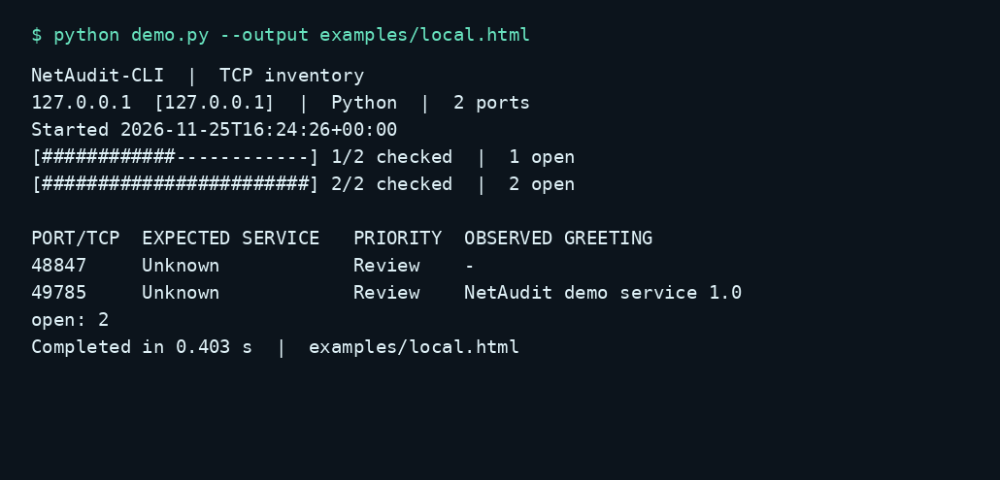

# NetAudit-CLI

[Français](README.md) · **English**

Inventory the reachable TCP services of one authorized host and share the results as a self-contained HTML report, a JSON record or a spreadsheet-friendly CSV. The native engine opens ordinary TCP connections using a bounded pool of worker threads. It records printable greetings offered by the remote service.

[Open the standalone example report](examples/local.html) by downloading it and opening it in a browser.

## Installation

Install Python 3.9 or newer, download or clone this repository, then open a terminal in the directory containing main.py. The native engine runs without pip or administrator privileges. On Windows use the Python launcher shown below. On Linux replace `py -3` with `python3`.

## First run

    py -3 demo.py --output report.html

Two temporary loopback services start on OS-assigned ports. One sends a version string and the other waits quietly. Both should appear as open. The listeners shut down when the demo finishes. Open report.html in a browser. The examples directory includes the actual local report, the terminal transcript and its rendered preview from the same run.

### Save a report screenshot on Windows

From PowerShell, after generating report.html, use an installed Microsoft Edge browser:

    $edge = @("${env:ProgramFiles(x86)}\Microsoft\Edge\Application\msedge.exe", "$env:ProgramFiles\Microsoft\Edge\Application\msedge.exe") | Where-Object { Test-Path $_ } | Select-Object -First 1
    $url = ([uri](Resolve-Path report.html).Path).AbsoluteUri
    & $edge --headless --disable-gpu --hide-scrollbars --window-size=1400,900 "--user-data-dir=$env:TEMP\netaudit-edge-preview" "--screenshot=$PWD\report.png" $url

For a terminal screenshot, leave the completed inventory visible and use Win+Shift+S.

## Commands

    python3 main.py 127.0.0.1 --ports 1-1024 --threads 8 --output report.html
    python3 main.py localhost -p 22,53,80,443,3306,3389,8080 -t 4 -o report.json
    python3 main.py ::1 -p 22,80,8000-8003 -o report.csv
    python3 main.py --help

The default port list is 22,80,443. The default concurrency is 8 (valid range 1–32). Mixed lists and inclusive ranges are accepted. Choose an existing output directory. A successful export atomically replaces the named file.

## Public Nmap example

The Nmap project limits its published ScanMe permission to scanning with Nmap. For this host, install Nmap separately, make the executable available on PATH and use the optional engine. The TCP checks are then performed by Nmap. NetAudit resolves one address and renders the results.

    py -3 main.py scanme.nmap.org --via-nmap --ports 22,80,443 --threads 3 --output report.html

The optional backend uses a TCP connect scan and retains Nmap port states. It performs no version probes or banner collection. Nmap chooses its own effective parallelism within the supplied cap. This mode reports a running status and a completion count. See the [ScanMe usage terms](https://nmap.org/book/legal-issues.html).

## Reading results

| Field | Interpretation |
| --- | --- |
| Address | First TCP address returned by the system resolver. Supply a literal IP to choose another address. |
| Duration | Monotonic elapsed time including DNS and probes, excluding export. |
| Open | TCP connection succeeded from the machine running the scan. |
| Refused | The connection attempt received an explicit refusal. |
| Timeout / error | No result within the deadline, or a network error. Reachability remains uncertain. |
| Expected service | Conventional assignment for the port number. Custom ports may say Unknown. |
| Observed greeting | First printable ASCII line from one read of up to 256 bytes after connect. A version appears only when the service volunteers it. HTTP, HTTPS and many other services typically wait for a request. |
| Review priority | High for selected cleartext, data-store and remote-access ports, Review for exposure requiring context, Info for common encrypted web/mail ports. All three warrant comparison with the host's intended configuration. |

The native engine uses a 1.5-second connection timeout and a 0.4-second greeting timeout. The inventory covers TCP, including TCP/53. UDP reachability, software patch status and vulnerability severity require separate evidence.

HTML and JSON include scan metadata and state counts. CSV contains one row per open port with scan metadata repeated on each row. A scan with no open ports produces a header-only CSV. JSON retains literal printable banner text. CSV prefixes formula-like strings for safer spreadsheet import.

## Authorized use

Use this tool for education and for systems you own or have explicit permission to assess. Agree on the target, ports and timing before a client engagement. Review reports before publishing them, as hostnames and service greetings can contain infrastructure details.
