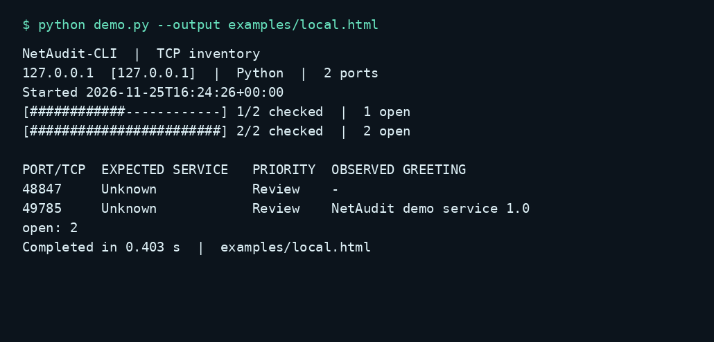

# NetAudit-CLI

**Français** · [English](README.en.md)


NetAudit-CLI inventorie les ports TCP accessibles sur un hôte depuis la machine qui exécute le scan. Il résout le nom de domaine, ouvre plusieurs connexions en parallèle et relève la bannière des services qui en envoient une. Les résultats s’exportent en HTML autonome, JSON ou CSV.



## Lancer la démo sous Windows

Installe Python 3.9 ou une version ultérieure. Avec Git et PowerShell, exécute les commandes suivantes.

```powershell
git clone https://github.com/raid-afk/NetAuditor.git
cd NetAuditor
py -3 demo.py --output report.html
if ($LASTEXITCODE -eq 0) { Start-Process .\report.html }
```

Si tu télécharges le ZIP depuis GitHub, extrais-le puis ouvre PowerShell dans le dossier contenant `demo.py`. Commence à la troisième ligne. Sous Linux, utilise `python3 demo.py --output report.html` puis ouvre le fichier dans ton navigateur.

La démo démarre deux services sur des ports locaux attribués par le système. L’un envoie la bannière `NetAudit demo service 1.0`, l’autre attend en silence. Les deux apparaissent comme ouverts. Ils s’arrêtent automatiquement à la fin de la démonstration. [Télécharger le rapport HTML d’exemple](examples/local.html)

## Utilisation

```bash
python3 main.py 127.0.0.1 --ports 1-1024 --threads 8 --output report.html
python3 main.py localhost -p 22,53,80,443,3306,3389,8080 -t 4 -o report.json
python3 main.py ::1 -p 22,80,8000-8003 -o report.csv
python3 main.py --help
```

| Argument | Utilisation |
| --- | --- |
| Cible | Adresse IPv4, IPv6 ou nom de domaine. Le scan porte sur la première adresse TCP renvoyée par le système. |
| `-p`, `--ports` | Liste, plage inclusive ou mélange des deux. Par défaut, 22, 80 et 443. |
| `-t`, `--threads` | Entre 1 et 32 connexions simultanées, 8 par défaut. |
| `-o`, `--output` | Fichier HTML, JSON ou CSV dans un dossier existant. Le rapport remplace le fichier du même nom après un export réussi. |
| `--via-nmap` | Utilise l’exécutable Nmap installé sur la machine pour vérifier les ports. |

## Lire un rapport

- **Port ouvert** signifie que la connexion TCP a abouti. Un refus explicite et un dépassement de délai sont comptabilisés séparément. Un délai expiré laisse l’état du port incertain.
- **Service attendu** désigne l’usage habituel du numéro de port. La colonne de bannière indique les caractères réellement reçus. HTTP et HTTPS attendent généralement une requête et peuvent apparaître sans bannière.
- **Priorité de revue** indique quels ports méritent une vérification selon leur usage habituel. Par exemple, un port associé à une base de données reçoit une priorité élevée. Pour conclure sur le risque, vérifie quel service écoute et qui doit pouvoir y accéder.
- **Durée** couvre la résolution DNS et les connexions. Le moteur Python attend jusqu’à 1,5 seconde pour se connecter, puis 0,4 seconde pour lire jusqu’à 256 octets de bannière.

Le HTML et le JSON incluent la date UTC, la cible, l’adresse, la durée et le décompte des états. Le CSV contient une ligne par port ouvert. Si aucun port ouvert n’est observé, il contient uniquement les en-têtes.

## Essai avec Nmap

Pour tester sur `scanme.nmap.org`, installe Nmap, vérifie que la commande `nmap` est accessible puis lance le mode dédié. Nmap effectue les connexions TCP et NetAudit produit le rapport. La collecte passive de bannières est disponible avec le moteur Python. [Conditions d’utilisation de ScanMe](https://nmap.org/book/legal-issues.html)

```powershell
py -3 main.py scanme.nmap.org --via-nmap --ports 22,80,443 --threads 3 --output report.html
```

## Usage autorisé

Utilise cet outil à des fins pédagogiques sur tes machines ou sur des systèmes pour lesquels tu as une autorisation explicite. Pour une mission, définis avec le client les cibles, les ports et le créneau du scan. Vérifie les adresses et les bannières avant de partager un rapport.
